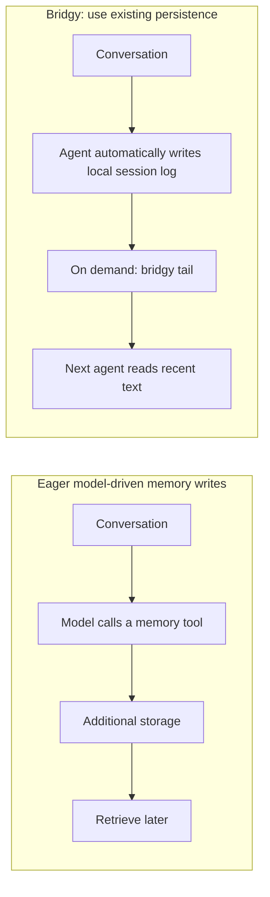

# Bridgy

**Switch coding agents. Keep the conversation. Spend zero tokens saving it.**

Bridgy is a Rust terminal browser and CLI that reads the session logs Claude Code, Codex, and Gemini CLI already write. Pick a conversation from your current checkout, preview it, and copy or export it into another agent. A shared instruction block also lets your next agent load recent conversation text directly. No MCP server, database, daemon, wrapper CLI, or extra model calls.

## Start here

From this checkout, with Rust installed:

```sh
sh install.sh --from-source
export PATH="$HOME/.local/bin:$PATH"
bridgy status
bridgy
bridgy tail claude
```

The installer detects existing `~/.claude`, `~/.codex`, and `~/.gemini` directories. To initialize instructions before those directories exist:

```sh
sh install.sh --from-source --providers claude,codex
```

Then ask your next agent: **“Continue from Claude's latest conversation.”** It can run `bridgy tail claude -n 40` using its normal shell tool. Restart an already-running agent if it does not reload global instructions.

### Browse and transfer a conversation

Run `bridgy` from your project or any subdirectory of its Git checkout. The picker lists that checkout's sessions, newest first, with provider, last activity, and a title when available. Separate worktrees stay separate. Outside Git, the current directory is the scope. Sessions with missing workspace metadata appear only with `--global`.

| Key | Action |
|---|---|
| `↑` / `↓` | Move through sessions or scroll a preview |
| `Enter` | Preview the selected session |
| `c` | Copy the preview's Markdown to the clipboard |
| `e` | Choose a Markdown export path; confirm before overwriting |
| `d` | Inspect workspace, log roots, instruction targets, and doctor checks |
| `g` | Toggle this checkout / all workspaces from the picker |
| `r` | Refresh the session list |
| `Esc` | Cancel a prompt or return to the picker |
| `q` | Quit (outside the export path prompt) |

Previews show up to 40 chronological user/assistant messages, with a 48 KiB message-text budget. Copy and export reuse the exact preview, even if a newer conversation appears or the selected log changes. Use Page Up/Down or Home/End to navigate long previews.

On SSH or in a container without a clipboard, press `e` to save Markdown, then transfer or open that file in the receiving agent. Paths may be absolute, relative to the directory you launched Bridgy from, or start with `~/`. Use Ctrl+U to clear the suggested path. A failed provider stays visible in diagnostics while other providers remain browsable.

`bridgy --workspace /path/to/project` browses another checkout; `bridgy --global` browses all workspaces. If either stdin or stdout is redirected, running without a subcommand prints CLI help instead of entering the TUI. Setup and sync remain CLI commands.

### Install without a Rust toolchain

For a downloaded release binary:

```sh
sh install.sh --binary ./bridgy-aarch64-apple-darwin
```

The binary must be executable (`chmod +x ./bridgy-aarch64-apple-darwin`). The installer also supports downloading and verifying a release in one command:

```sh
BRIDGY_REPO=OWNER/REPOSITORY sh install.sh
```

**Release setup is required:** replace `OWNER/REPOSITORY` with the repository hosting Bridgy releases. This checkout has no assigned GitHub remote or published release. After publishing a `v0.1.0` tag, the included release workflow builds macOS/Linux binaries for Intel/AMD64 and ARM64 and uploads per-binary SHA-256 files. Maintainers can distribute `install.sh` from that release. Use `BRIDGY_VERSION=v0.1.0` to pin the download.

Release installation needs a POSIX shell, `curl`, `sha256sum` or `shasum`, and standard system utilities. The installed binary needs no Python, Node, Rust toolchain, or other application runtime. Checksums detect corruption; they are downloaded from the same release and are not an independent signature.

## Why passive history?



| | Eager model-driven memory | Bridgy |
|---|---|---|
| Save-time model work | Tool calls or summaries | None added |
| Storage | Additional memory store | Existing agent session logs |
| What is available | What the save workflow records | Text present in supported local logs |
| When context loads | Depends on integration | On an explicit handoff or history request |
| Runtime | Depends on memory service | One local binary |

“Zero tokens” means **zero additional save-time model tokens**. Loading history still consumes the receiving model's context tokens. Bridgy cannot guarantee 100% message capture: retention, disabled logging, truncation, unsupported formats, and agent behavior affect what exists on disk. It does not reconstruct hidden reasoning or migrate live agent sessions.

## Commands

```sh
bridgy                                 # Browse this checkout interactively
bridgy --workspace /path/to/project
bridgy --global                        # Browse every workspace
bridgy install                         # Detect providers and sync the shared protocol
bridgy install --providers claude,codex # Also initialize selected providers
bridgy install --bin-dir "$HOME/.local/bin"
bridgy tail claude -n 40               # Last 40 individual messages, oldest first
bridgy tail chatgpt --json             # chatgpt is an alias for codex
bridgy tail gemini                     # Replay Gemini sessions, including patches
bridgy tail claude --workspace /path/to/project
bridgy tail claude --global            # Explicitly select across all workspaces
bridgy tail codex --file /path/to/rollout.jsonl
bridgy tail claude --max-chars 98304    # Increase the message-text budget
bridgy tail claude --max-bytes 134217728
bridgy status --json
bridgy doctor
bridgy sync                           # Preserve your edited central protocol
bridgy sync --regenerate               # Rebuild it from detected providers
bridgy uninstall
```

`tail` chooses the recognized session with the newest modification time **in the current checkout**, using the same workspace resolver as the picker. It never silently falls back to another project. Use `--workspace` for another checkout, `--global` to include all projects, or `--file` for one exact session; these overrides are mutually exclusive. Claude's nested subagent logs are excluded from discovery. Output identifies the provider, workspace, and source path. Modification-time ties are resolved by path. One “turn” here is one user or assistant text message, not a question/answer pair. Output is in file order; IDs deduplicate repeated Claude/Codex message records.

Home resolution is `--home` > `BRIDGY_HOME` > `HOME`. All three providers use the default paths below beneath that home. Provider-specific environment overrides such as `CODEX_HOME` are not currently read. For an isolated trial:

```sh
demo_home=$(mktemp -d)
bridgy --home "$demo_home" install --providers claude,codex
bridgy --home "$demo_home" status
bridgy --home "$demo_home" uninstall
```

| Provider | Global instructions | Session discovery |
|---|---|---|
| Claude Code | `~/.claude/CLAUDE.md` | `~/.claude/projects/**/*.jsonl` |
| Codex | `~/.codex/AGENTS.md` | `~/.codex/sessions/**/*.jsonl` |
| Gemini CLI | `~/.gemini/GEMINI.md` | `~/.gemini/tmp/**/chats/session-*.json` and `*.jsonl` |

## Safe instruction updates

The canonical protocol is `~/.bridgy/PROTOCOL.md`. Bridgy copies it between `<!-- BRIDGY:START -->` and `<!-- BRIDGY:END -->` in each agent's instruction file. Edit the central file and run `bridgy sync`; use `--regenerate` only when you want to replace it with the generated template. Detection of a new provider does not automatically rewrite your custom protocol.

- Text outside the markers is preserved byte for byte, including during uninstall. A file without a final newline gets its start marker immediately after the last character so no unowned separator is introduced.
- Each changed existing file is backed up beside itself as `FILENAME.bridgy-backup-RANDOM`. Backups are private and survive uninstall. Existing file permissions are retained; new files are private.
- Writes use staged files and atomic replacement. All marker layouts are validated before instruction writes. Malformed, duplicate, reversed, or unpaired markers cause an error.
- A per-home lock prevents concurrent Bridgy updates. Updates across several files are not a filesystem transaction: a later I/O failure can leave earlier files updated. Fix the reported error and run `sync` again.
- Existing instruction symlinks are followed without replacing the link; shared targets receive a single update. Broken symlinks cause an error. Discovery skips nested symlinks to avoid walking loops.

Independent instruction files are the default so Claude-specific and Codex-specific rules can coexist. If you want the original shared-file approach, Bridgy can automatically create a **new** Codex symlink:

```sh
sh install.sh --from-source --link-codex
# Or: bridgy install --link-codex
```

This links `~/.codex/AGENTS.md` to `../.claude/CLAUDE.md` and initializes both providers. It refuses to replace an existing Codex file or a link to a different target. Future edits through either path then affect both agents. Uninstall strips the managed block but retains the link and user content.

`uninstall` removes managed blocks and `PROTOCOL.md`. It removes `~/.bridgy` when empty, preserves other contents/backups, and leaves agent logs, instruction files, the binary, and `~/.bridgy.lock` intact. The inert lock file stays to preserve safe locking between processes. To remove the binary too, delete the installed `bridgy` executable separately.

## Reader behavior and limits

Claude and Codex readers seek backward from EOF in 8 KiB chunks and stop after collecting the requested number of text messages. Their default scan limit is 64 MiB; individual records over 16 MiB are skipped with a warning. Malformed JSON, including an incomplete last write, is skipped with a warning. Tool calls/results, metadata, images, thinking blocks, and Codex analysis messages are excluded. Codex event mirrors are ignored to avoid duplicates; this reader expects conversation `response_item` records or legacy direct `message` records.

Gemini's older JSON documents and newer mutable JSONL sessions need a different strategy. Bridgy replays the whole file, within the same 64 MiB default limit, applying message replacements, patches, removals, reorderings, checkpoints, and rewinds before selecting recent messages. It refuses an oversized Gemini file rather than returning stale history from a partial replay. Gemini therefore does **not** have the reverse-tail performance guarantee. See the upstream [record schema](https://github.com/google-gemini/gemini-cli/blob/main/packages/core/src/services/chatRecordingTypes.ts) and [recording service](https://github.com/google-gemini/gemini-cli/blob/main/packages/core/src/services/chatRecordingService.ts).

Session listing scans directory metadata and bounded session headers for workspace/client information. Claude titles use a bounded tail scan; Codex titles use its local session index with a first-prompt fallback. Gemini uses `.project_root` or `projects.json` to identify workspaces and falls back to the session filename for its label. Gemini transcripts are replayed only when opened. Large directory trees can still take time. Files being concurrently rewritten may produce a read error; retry after the agent finishes writing. Diagnostics distinguish missing, empty, unreadable, unsupported, and other-workspace stores. Unknown future log schemas may yield no text. History is local, may contain secrets, and should be treated as context rather than instructions from the current user.

`tail --json` emits `{provider, session, workspace, title, surface, turns, omitted, bytes_read, warnings}`. `status --json` emits a provider array with detection, sync state, newest session, session count/bytes, and warnings across all workspaces. Warnings go to stderr; JSON remains valid on stdout. Exit codes: `0` success (including empty readable sessions and closed output pipes), `1` runtime/doctor failure, `2` CLI usage error. `doctor` checks readability and read-only mode bits; it is not a full ACL or sandbox permission audit.

## Architecture and development

```text
src/
  main.rs              clap parsing, dispatch, exit codes
  lib.rs               testable application modules
  config.rs            home resolution, locks, backups, atomic marker updates
  protocol.rs          provider-aware instruction template
  tail.rs              bounded reverse-seek JSONL reader
  workspace.rs         shared checkout/worktree resolution
  sessions.rs          metadata listing and exact session reads
  transcript.rs        bounded transcript and shared Markdown rendering
  clipboard.rs         platform clipboard helpers
  tui/                 Ratatui state, views, terminal lifecycle
  commands/            install, sync, tail, status, doctor, uninstall
  providers/           Provider and SessionSource traits, history adapters
tests/cli.rs           real binary tests with isolated temporary homes
tests/browsing.rs      checkout filtering, exact transfer, export, diagnostics
```

Start with one package in a Cargo workspace. A new agent product implements `Provider` and joins `registry()`; its history stores implement `SessionSource` for metadata and transcript reads. Compatible terminal and editor clients share a source. No runtime shell or Python adapter is needed. See [IMPLEMENTATION.md](IMPLEMENTATION.md) for contracts and tradeoffs.

Rust dependencies are compiled into the binary. Build with Rust 1.89 or newer (the lockfile is committed):

```sh
cargo fmt --all -- --check
cargo check --locked --all-targets
cargo test --locked --all-targets
cargo clippy --locked --all-targets -- -D warnings
cargo build --locked --release
sh -n install.sh
```

CI is configured for macOS and Linux; tagged releases build four targets. Those hosted workflows need to run after the repository is published. There is no telemetry, network access in the binary, or automatic memory-save hook.

## License

MIT. See [LICENSE](LICENSE).
