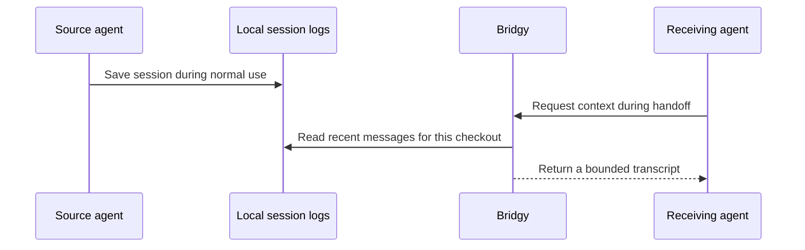

# bridgy.

**Pick up in one AI coding agent where you left off in another.**

Bridgy is a local conversation browser and handoff tool for **Claude Code, Codex, and Gemini CLI**. It reads the session history your agents already save. If Claude stops mid-task, open Codex in the same checkout and ask:

> Pick up where I left off in Claude.

You can also open Bridgy's terminal browser to find a specific conversation, preview it, and copy or export it.

## Install Bridgy

With Rust and Cargo installed, run this command from any directory on macOS, Linux, or Windows. If you need Cargo, install [Rust](https://rustup.rs/) first and reopen your terminal.

```sh
cargo install --locked --git https://github.com/glantrox/bridgy
```

Open a fresh terminal in the project where you use your coding agent. Check the installation, then launch the browser.

```sh
bridgy --version
bridgy
```

If your terminal can’t find `bridgy`, add the bin directory printed by Cargo to your `PATH`, then reopen the terminal.

**Optional agent handoffs.** Run `bridgy install` once, then start a fresh agent session in the same checkout and ask it to pick up where you left off.

## Browse or export a conversation

Run `bridgy` to see conversations for the current checkout, newest first. Each session shows its title above the provider, client (when available), and last activity. On terminals at least 80 columns wide, the selected conversation appears on the right after a short pause. On narrower terminals, press Enter to open it.

| Key | Action |
| --- | --- |
| ↑ / ↓ | Move through the session list |
| Enter / Esc | Focus the preview / return to the list |
| `c` | Copy the preview |
| `e` | Export the preview as Markdown |
| `?` | Show all shortcuts, including diagnostics, workspace switching, and import |

Copy and export use Markdown from the same session snapshot shown in the preview. Bridgy asks before overwriting an existing export.

## CLI reference

```sh
bridgy tail claude          # Latest Claude Code conversation in this checkout
bridgy tail codex           # Latest Codex conversation in this checkout
bridgy tail gemini          # Latest Gemini CLI conversation in this checkout
bridgy tail claude --global # Search across projects
bridgy doctor              # Check history locations and instruction setup
```

To select a specific transcript file, use `bridgy tail <provider> --file <path>`. The default scope is the current Git checkout, including from a subdirectory. Separate worktrees stay separate. Outside Git, Bridgy uses the current directory.

## How it works



Bridgy detects readable logs under the agent's local data directory. Terminal and editor conversations appear when they use a supported local format. Account sign-in status and whether an agent is currently running are independent of which logs Bridgy can read.

By default, Bridgy returns up to **40 recent user and assistant messages**, in chronological order, with a **48 KiB limit on message text**. It omits tool output, images, and hidden reasoning. The receiving agent starts with the retrieved conversation context in its own session.

**Zero extra AI tokens to save history.** Browsing and exporting happen locally without model calls. The receiving agent uses input tokens when it reads the handoff. Bridgy runs on demand without a background service or cloud upload.

## Agent setup and troubleshooting

- `bridgy install` adds a marked block to supported agent instruction files while preserving your rules.
- `bridgy sync` reapplies the shared protocol from `~/.bridgy/PROTOCOL.md`.
- `bridgy uninstall` removes Bridgy's managed blocks while preserving your agent instructions outside those blocks and your session logs.

If a conversation is missing, run `bridgy doctor` to see which locations Bridgy checked. For SSH, WSL, or dev containers, run Bridgy in the environment where the source agent saved its logs. If your next agent runs elsewhere, export the preview as Markdown and bring it into the new chat.

## Development

```sh
cargo test
cargo build --release
```
